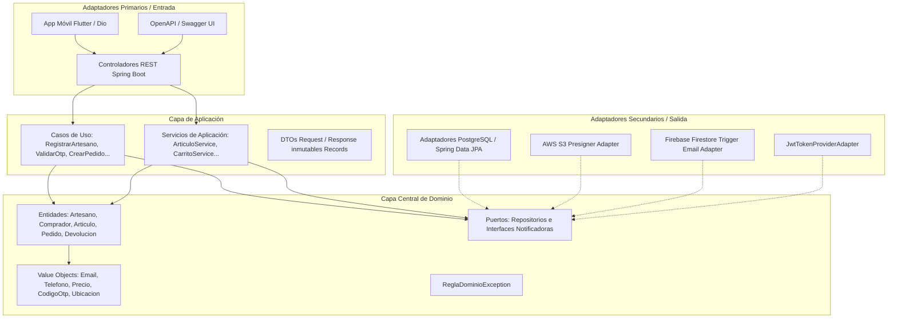
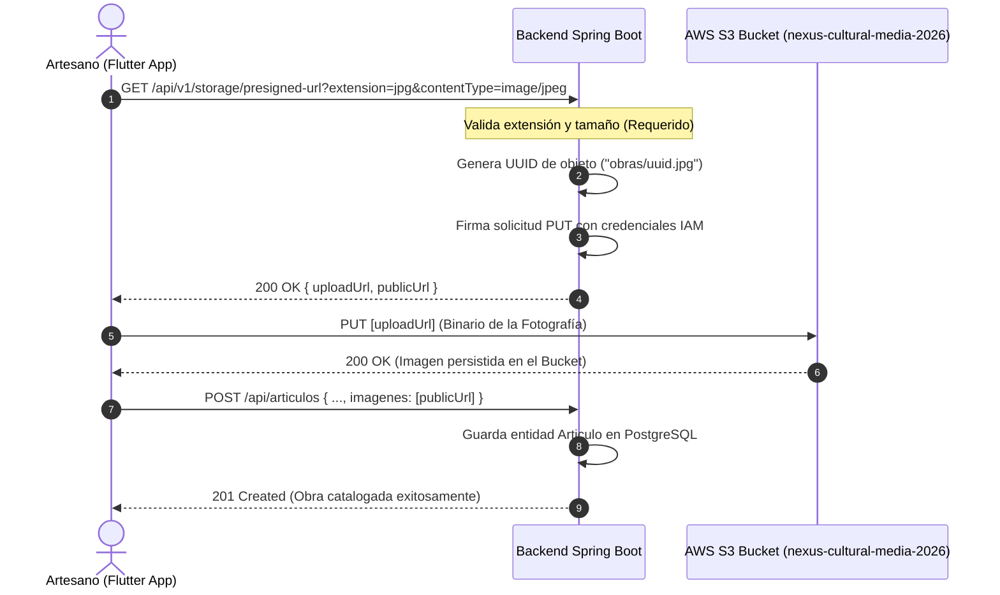

# Nexus Cultural S.A.S. — Especificación de Arquitectura de Software y Contratos de API REST

> **Documento:** NEXUS-DOC-ARQ-Arquitectura_Hexagonal_Contratos_API_v1.0  
> **Proyecto:** Nexus Cultural (Ecosistema Digital de Comercio Ancestral)  
> **Backend Framework:** Spring Boot 3.3.4 (Java 17 / 21)  
> **Frontend Framework:** Flutter 3.x / Dart 3.x (Multiplataforma)  
> **Fecha de Elaboración:** Octubre de 2026  
> **Ubicación Recomendada en Repositorio:** `documentacion/arquitectura/ARQUITECTURA_Y_ENDPOINTS.md`

---

## 1. Visión General de la Arquitectura (Hexagonal / Clean Architecture)

El backend de **Nexus Cultural** adopta los principios de **Arquitectura Hexagonal (Puertos y Adaptadores)** y **Diseño Guiado por el Dominio (DDD)**, asegurando que la lógica del negocio permanezca desacoplada de los frameworks externos y los mecanismos de persistencia.

---

## 2. Matriz Completa de Endpoints REST (Contrato de API)

### 2.1. Módulo: Autenticación e Identidad (`/api/usuarios`)

| Método | Endpoint | Rol Requerido | Request Body / Params | Response Body / Status | Descripción y Vulnerabilidades Detectadas |
| :---: | :--- | :---: | :--- | :--- | :--- |
| `POST` | `/api/usuarios/solicitar` | **Público** | `{"email": "string"}` | `{"mensaje": "string", "exito": true}` `(200 OK)` | Genera y despacha código OTP de 6 dígitos al correo. **Vulnerabilidad:** Sin rate limiting; permite email bombing. |
| `POST` | `/api/usuarios/verificar` | **Público** | `{"email": "string", "codigo": "123456"}` | `{"token": "JWT", "tipo": "Bearer", "rol": "ARTESANO", "expiracion": 86400}` `(200 OK)` | Valida el OTP y retorna token JWT con 24 horas de vigencia. **Vulnerabilidad:** OTP generado con `Random()` no criptográfico; sin bloqueo tras intentos fallidos. |

---

### 2.2. Módulo: Gestión de Usuarios (`/api/administradores`, `/api/artesanos`, `/api/compradores`)

| Método | Endpoint | Rol Requerido | Request Body / Params | Response Body / Status | Descripción y Vulnerabilidades Detectadas |
| :---: | :--- | :---: | :--- | :--- | :--- |
| `POST` | `/api/administradores` | **CRÍTICO: Público (`permitAll`)** | `{"nombreCompleto": "...", "email": "...", "nivelAcceso": "SUPER_ADMIN"}` | `AdministradorResponse` `(201 Created)` | **FALLA CRÍTICA DE SEGURIDAD:** El endpoint está expuesto sin autenticación en `SecurityConfig`, permitiendo a cualquier atacante crear super administradores. |
| `GET` | `/api/administradores` | `ADMINISTRADOR` | Ninguno | `List<AdministradorResponse>` `(200 OK)` | Retorna el listado completo de administradores del sistema. |
| `GET` | `/api/administradores/{id}` | `ADMINISTRADOR` | Path: `id` (UUID) | `AdministradorResponse` `(200 OK)` | Consulta detalle administrativo por ID. |
| `PUT` | `/api/administradores/{id}` | `ADMINISTRADOR` | `ActualizarAdministradorRequest` | `AdministradorResponse` `(200 OK)` | Modifica datos básicos del administrador. |
| `POST` | `/api/artesanos` | **Público** | `RegistrarArtesanoRequest` | `ArtesanoResponse` `(201 Created)` | Registro inicial de un artesano y su trayectoria cultural. |
| `GET` | `/api/artesanos/{id}/logros` | `ARTESANO`, `ADMINISTRADOR` | Path: `id` (UUID) | `List<LogroResponse>` `(200 OK)` | Consulta insignias y reconocimientos de gamificación. |
| `POST` | `/api/compradores` | **Público** | `RegistrarCompradorRequest` | `CompradorResponse` `(201 Created)` | Registro de un nuevo comprador en la plataforma. |
| `GET` | `/api/compradores/{id}` | `COMPRADOR`, `ADMINISTRADOR` | Path: `id` (UUID) | `CompradorResponse` `(200 OK)` | Consulta perfil del comprador. |

---

### 2.3. Módulo: Catálogo y Publicación de Obras (`/api/catalogo`, `/api/articulos`)

| Método | Endpoint | Rol Requerido | Request Body / Params | Response Body / Status | Descripción y Vulnerabilidades Detectadas |
| :---: | :--- | :---: | :--- | :--- | :--- |
| `GET` | `/api/catalogo` | **Público** | Query: `grupo` (opcional) | `List<ArticuloDetalleResponse>` `(200 OK)` | Lista piezas disponibles; filtrado opcional por categoría. |
| `GET` | `/api/catalogo/buscar` | **Público** | Query: `query` (string) | `List<ArticuloDetalleResponse>` `(200 OK)` | Búsqueda por palabra clave en título y descripción. |
| `GET` | `/api/catalogo/artesano/{id}` | **Público** | Path: `id` (UUID) | `List<ArticuloDetalleResponse>` `(200 OK)` | Retorna todas las obras creadas por un artesano específico. |
| `GET` | `/api/articulos/{id}` | **Público** | Path: `id` (UUID) | `ArticuloDetalleResponse` `(200 OK)` | Detalle completo de una pieza artesanal. |
| `POST` | `/api/articulos` | `ARTESANO`, `ADMINISTRADOR` | `CrearArticuloRequest` | `ArticuloDetalleResponse` `(201 Created)` | Publica una nueva obra. **Defecto de Lógica:** El frontend Flutter invoca este endpoint al editar obras, generando duplicados en BD. |
| `PUT` | `/api/articulos/{id}/inventario` | `ARTESANO`, `ADMINISTRADOR` | Path: `id`, Body: `ActualizarInventarioRequest` | `ArticuloDetalleResponse` `(200 OK)` | Ajusta el stock del artículo. **Defecto:** El Controller ignora el `id` del PathVariable. |
| `PATCH` | `/api/articulos/{id}/reponer` | `ARTESANO`, `ADMINISTRADOR` | `{"stock": int}` | `ArticuloDetalleResponse` `(200 OK)` | Incrementa el stock disponible. |
| `PATCH` | `/api/articulos/{id}/inactivar` | `ARTESANO`, `ADMINISTRADOR` | Query: `artesanoId` | `ArticuloDetalleResponse` `(200 OK)` | Suspende temporalmente la venta del artículo. |
| `PATCH` | `/api/articulos/{id}/reactivar` | `ARTESANO`, `ADMINISTRADOR` | Query: `artesanoId` | `ArticuloDetalleResponse` `(200 OK)` | Habilita nuevamente la venta de la pieza. |

---

### 2.4. Módulo: Almacenamiento S3 y URLs Prefirmadas (`/api/v1/storage`)

| Método | Endpoint | Rol Requerido | Request Body / Params | Response Body / Status | Descripción y Vulnerabilidades Detectadas |
| :---: | :--- | :---: | :--- | :--- | :--- |
| `GET` | `/api/v1/storage/presigned-url` | **CRÍTICO: Público (`permitAll`)** | Query: `extension`, `contentType` | `{"uploadUrl": "...", "publicUrl": "..."}` `(200 OK)` | **VECTORES DE RIESGO SEVERO:** Genera URL prefirmada de subida a AWS S3. Cualquier atacante no autenticado puede solicitar URLs infinitas sin límite de tamaño ni validación de tipo de archivo, permitiendo DoS y sobrecostos financieros en AWS. |

---

### 2.5. Módulo: Carrito de Compras (`/api/compradores/{compradorId}/carrito`)

| Método | Endpoint | Rol Requerido | Request Body / Params | Response Body / Status | Descripción y Vulnerabilidades Detectadas |
| :---: | :--- | :---: | :--- | :--- | :--- |
| `GET` | `/api/compradores/{id}/carrito` | `COMPRADOR`, `ADMINISTRADOR` | Path: `compradorId` | `List<CarritoItemResponse>` `(200 OK)` | Retorna los ítems en el carrito del comprador. |
| `POST` | `/api/compradores/{id}/carrito/items` | `COMPRADOR`, `ADMINISTRADOR` | `{"articuloId": "...", "cantidad": 1}` | `CarritoItemResponse` `(201 Created)` | Agrega ítem. **Falla de Negocio:** No consolida productos existentes; inserta filas duplicadas. |
| `PUT` | `/api/compradores/{id}/carrito/items/{itemId}` | `COMPRADOR`, `ADMINISTRADOR` | `{"cantidad": int}` | `CarritoItemResponse` `(200 OK)` | Actualiza la cantidad de un ítem. |
| `DELETE` | `/api/compradores/{id}/carrito/items/{itemId}` | `COMPRADOR`, `ADMINISTRADOR` | Path: `compradorId`, `itemId` | `204 No Content` | Elimina una línea del carrito. |
| `DELETE` | `/api/compradores/{id}/carrito` | `COMPRADOR`, `ADMINISTRADOR` | Path: `compradorId` | `204 No Content` | Vacía por completo el carrito de compras. |

---

### 2.6. Módulo: Pedidos, Pagos y Devoluciones (`/api/pedidos`)

| Método | Endpoint | Rol Requerido | Request Body / Params | Response Body / Status | Descripción y Vulnerabilidades Detectadas |
| :---: | :--- | :---: | :--- | :--- | :--- |
| `POST` | `/api/pedidos` | `Autenticado (Cualquier rol)` | `CrearPedidoRequest` | `PedidoResponse` `(201 Created)` | Crea pedido para 1 artículo y descuenta stock. **Defecto:** No es transaccional y el frontend lo ejecuta en bucle 1 a 1 en lugar de atómico. |
| `GET` | `/api/pedidos/{id}` | `Autenticado (Cualquier rol)` | Path: `id` (UUID) | `PedidoResponse` `(200 OK)` | Detalle de pedido. **Vulnerabilidad IDOR:** Cualquier usuario puede ver pedidos ajenos. |
| `GET` | `/api/pedidos/comprador/{id}` | `Autenticado (Cualquier rol)` | Path: `compradorId` | `List<PedidoResponse>` `(200 OK)` | Historial de compras del cliente. |
| `GET` | `/api/pedidos/artesano/{id}` | `Autenticado (Cualquier rol)` | Path: `artesanoId` | `List<PedidoResponse>` `(200 OK)` | Obras vendidas por el artesano. |
| `POST` | `/api/pedidos/pago` | `Autenticado (Cualquier rol)` | `ProcesarPagoRequest` | `PedidoResponse` `(200 OK)` | Registra la confirmación de pago y transiciona el pedido a `CONFIRMADO`. |
| `PATCH` | `/api/pedidos/{id}/avanzar` | `Autenticado (Cualquier rol)` | Path: `id` (UUID) | `PedidoResponse` `(200 OK)` | Avanza estado operativo del pedido. |
| `PATCH` | `/api/pedidos/{id}/entregar` | `Autenticado (Cualquier rol)` | Path: `id` (UUID) | `PedidoResponse` `(200 OK)` | **RIESGO DE ESTABILIDAD:** Contiene un bucle `while` en controlador para forzar estado `ENTREGADO`. |
| `POST` | `/api/pedidos/devolucion` | `Autenticado (Cualquier rol)` | `DevolverProductoRequest` | `PedidoResponse` `(200 OK)` | Radica solicitud de garantía dentro de los 5 días de entrega. |

---

### 2.7. Módulo: Control de Versiones Móviles (`/api/app-version`)

| Método | Endpoint | Rol Requerido | Request Body / Params | Response Body / Status | Descripción |
| :---: | :--- | :---: | :--- | :--- | :--- |
| `GET` | `/api/app-version` | **Público** | Ninguno | `{"minVersion": "1.0.1", "latestVersion": "1.0.1", "forceUpdate": false, "updateUrl": "...", "message": "..."}` `(200 OK)` | Provee información sobre la versión mínima requerida para la app Flutter. |

---

## 3. Flujo de Almacenamiento Multimedia con URLs Prefirmadas (S3)

---

## 4. Brechas de Seguridad Arquitectónicas Identificadas

1. **Ausencia de Configuración CORS (`CrossOrigin`):**
   - No se detecta un `CorsConfigurationSource` en Spring Security. Clientes web que consuman la API experimentarán bloqueo por políticas de mismo origen.
2. **Uso de HTTP Plano en Móvil (`ApiClient._awsUrl`):**
   - La aplicación móvil Flutter se comunica por defecto con un protocolo http al servidor de nexus cultural, al hacerlo sin TLS/HTTPS, hay riesgos de exponer tokens y datos en tránsito a ataques Man-in-the-Middle.
3. **Falta de Trazabilidad y Auditoría Transaccional:**
   - No existen tablas ni entidades de auditoría (`auditoria_sistema`) para registrar intentos fallidos de autenticación, cambios de stock ni modificaciones de roles.
