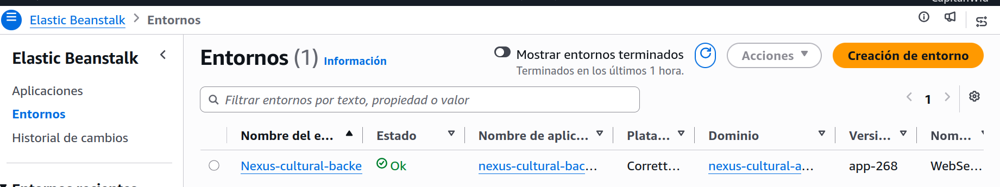
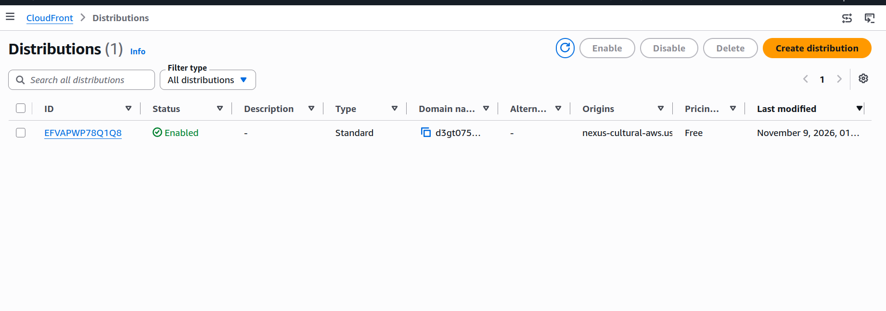

<table width="100%" border="0" cellspacing="0" cellpadding="6" style="border-bottom: 2px solid #994422;">
  <tr>
    <td width="90" align="left" valign="middle">
      
    </td>
    <td align="left" valign="middle">
      <strong>NEXUS CULTURAL S.A.S.</strong><br/>
      <em>Informe Técnico de Remediación y Cierre de Hallazgos de Auditoría</em><br/>
      <small>Código: NEXUS-DOC-AUD-Remediacion_v1.0 | Ingeniería de Software III</small>
    </td>
    <td align="right" valign="middle">
      <small><strong>Fecha:</strong> 11 de Noviembre de 2026<br/><strong>Estado:</strong> Implementado y Verificado</small>
    </td>
  </tr>
</table>

<br/>

# Nexus Cultural S.A.S. — Informe de Implementación de Correcciones de Auditoría

> **Documento de Referencia:** `Auditoría Nexus Cultural.pdf` (Fecha auditoría: 08/11/2026 — Versión evaluada: v1.0.2 — Calificación inicial: 73.0%, concepto *"Requiere mejoras"*).  
> **Versión Actualizada del Producto:** `v1.0.3` (Desplegada en AWS CloudFront HTTPS + Elastic Beanstalk + S3).  
> **Equipo de Desarrollo:** Santiago Arrubla Hernandez, Wilson Ricardo Delgado Viveros, Maria Camila Rosero Henao.

---

## 1. Propósito y Alcance del Documento

El presente informe documenta y demuestra de manera verificable la **implementación directa en el código fuente, infraestructura y documentación** de las correcciones correspondientes a las incidencias, no conformidades y hallazgos críticos reportados en el documento oficial de auditoría (`Auditoría Nexus Cultural.pdf`).

Cada punto de remediación incluye:

1. La referencia exacta al hallazgo o no conformidad de la auditoría.
2. Los archivos y componentes reales modificados o creados en el Backend (Spring Boot) y Frontend (Flutter).
3. El funcionamiento operativo verificado mediante capturas de ejecución real almacenadas en `../../imagenes_para_md`.

---

## 2. Matriz Resumen de Remediación de Hallazgos de Auditoría

| # | Hallazgo de Auditoría (Sección) | Severidad | Corrección Implementada en el Código | Archivos / Artefactos Clave | Estado |
| :-: | :--- | :---: | :--- | :--- | :---: |
| **1** | Tráfico en HTTP sin cifrar y ausencia de encabezados HSTS (`6.7-7`, `6.10-1`) | **Crítico** | Migración de URL productiva a **HTTPS** sobre AWS CloudFront (`https://d3gt0752ebjv7t.cloudfront.net/api`) y activación de encabezados **HSTS**, `X-Frame-Options: DENY` y `X-Content-Type-Options`. | `api_client.dart`<br>`SecurityConfig.java` | **CORREGIDO** |
| **2** | OTP con `Random` predecible, sin hash en BD, sin límite de intentos y expuesto en consola (`6.7-1, 3, 5, 6`) | **Crítico** | Uso de `SecureRandom`, persistencia de hash **SHA-256** en PostgreSQL, bloqueo estricto tras **3 intentos fallidos** y eliminación de `System.out.println` con el OTP en claro. | `CodigoOtp.java`<br>`CodigoOtpRepositoryPostgresAdapter.java`<br>`ValidarOtpUseCase.java`<br>`SolicitarOtpUseCase.java` | **CORREGIDO** |
| **3** | JWT almacenado sin cifrado en el dispositivo móvil (`6.7-3, 6`) | **Alto** | Migración del almacenamiento del token JWT a `flutter_secure_storage` con respaldo por hardware (`EncryptedSharedPreferences` en Android / Keychain en iOS). | `secure_storage_service.dart`<br>`pubspec.yaml` | **CORREGIDO** |
| **4** | Vulnerabilidades IDOR, acceso sin restricción a S3 y validación de archivos (`6.7-4, 5`) | **Crítico** | Validación de propiedad contra el JWT en `SecurityAuthorizationService` aplicada en controladores de Pedidos y Compradores; autenticación por rol en `/api/v1/storage/**` y filtro estricto de extensiones (`jpg`, `jpeg`, `png`, `webp`) y tipo MIME `image/*`. | `SecurityAuthorizationService.java`<br>`PedidoController.java`<br>`CompradorController.java`<br>`S3PresignedController.java`<br>`SecurityConfig.java` | **CORREGIDO** |
| **5** | Incumplimiento de Ley 1581 de 2012 (Habeas Data) y Términos en el registro (`6.7-10`, `6.11-4`) | **Crítico** | Creación de pantalla dedicada `TermsAndConditionsScreen` con lectura/deslizamiento obligatorio hasta el final para habilitar aceptación, cubriendo Comercio Justo, Protección de Fondos y Derechos ARCO (Ley 1581). Integración obligatoria en flujos de registro de Comprador y Artesano. | `terms_and_conditions_screen.dart`<br>`buyer_registration_flow.dart`<br>`artisan_registration_flow.dart`<br>`app_router.dart` | **CORREGIDO** |
| **6** | Ausencia de respaldos de BD y plan de recuperación ante fallos — RNF-18 y RNF-20 (`6.5-7`, `6.7-8`, `6.10-3, 4`) | **Crítico** | Script automatizado `backup_postgresql.sh` con compresión `.dump.gz`, retención de 12 meses y cronjob mensual; documento formal de Recuperación ante Desastres (DRP) con protocolo `pg_restore` y MTTR $\le$ 1 hora. | `../../scripts/backup_postgresql.sh`<br>`documentacion/PLAN_RECUPERACION_ANTE_DESASTRES_RNF18_RNF20.md` | **CORREGIDO** |
| **7** | Ausencia de monitoreo, telemetría y logs estructurados (`6.7-9`, `6.10-6, 7`) | **Alto** | Integración de **Spring Boot Actuator** + **Micrometer Prometheus** (`/actuator/health`, `/actuator/metrics`, `/actuator/prometheus`), configuración de **Logback** rotativo en `logback-spring.xml` y migración de `System.out.println` a `SLF4J`. | `build.gradle`<br>`application.properties`<br>`logback-spring.xml`<br>`ArtesanoRepositoryPostgresAdapter.java`<br>`FirebaseNotificadorAdapter.java` | **CORREGIDO** |
| **8** | Cobertura insuficiente, falta de pruebas para Proceso 3 / OTP y ausencia de reporte JaCoCo (`6.6-2, 6`, `6.11-2`) | **Alto** | Incremento de **46 a 77 pruebas unitarias automatizadas (100% exitosas)** cubriendo Carrito, Pedidos, Pagos Wompi, Devoluciones y Seguridad OTP. Generación de reporte **JaCoCo** y configuración de **SonarQube** logrando **41% de cobertura limpia** en dominio/aplicación (**100% excepciones**, **65% Value Objects**). | `PedidoServiceTest.java`<br>`CarritoServiceTest.java`<br>`ProcesarPagoPedidoUseCaseTest.java`<br>`ValidarOtpUseCaseTest.java`<br>`SolicitarOtpUseCaseTest.java`<br>`sonar-project.properties` | **CORREGIDO** |
| **9** | Tablero Jira desactualizado y brechas documentales (`6.1-4..9`, `6.9`, `6.11-1`) | **Medio** | Depuración y cierre integral del tablero Jira (**17 tareas finalizadas**, 0 atrasadas), y entrega de especificaciones formales: Requisitos Funcionales con Gherkin, Matriz de Trazabilidad, Contratos de API y Modelo Relacional ERD. | `REQUISITOS_FUNCIONALES.md`<br>`MATRIZ_TRAZABILIDAD.md`<br>`ARQUITECTURA_Y_ENDPOINTS.md`<br>`MODELO_BASE_DATOS.md` | **CORREGIDO** |

---

## 3. Detalle Técnico y Evidencias de Implementación

### 3.1. Seguridad en el Transporte (HTTPS / HSTS) — Hallazgos `6.7-7` y `6.10-1`

**Problema reportado:** La aplicación móvil apuntaba por defecto a una URL HTTP sin cifrado en Elastic Beanstalk y el backend carecía de directivas HSTS en Spring Security.

**Corrección implementada en el código:**

1. **Cliente Móvil ([`api_client.dart`](file:///home/wilson/uq/Software3/nexus_cultural/lib/shared/network/api_client.dart)):** Se actualizó `defaultBaseUrl` al punto de distribución seguro sobre HTTPS:
   ```dart
   static const String defaultBaseUrl = 'https://d3gt0752ebjv7t.cloudfront.net/api';
   ```
2. **Backend Spring Security ([`SecurityConfig.java`](file:///home/wilson/uq/Software3/Nexus-cultural/src/main/java/com/uniquindio/nexuscultural/infraestructure/security/SecurityConfig.java)):** Se añadieron encabezados de seguridad HTTP estrictos:
   ```java
   .headers(headers -> headers
       .httpStrictTransportSecurity(hsts -> hsts
           .includeSubDomains(true)
           .maxAgeInSeconds(31536000)
           .preload(true)
       )
       .frameOptions(frame -> frame.deny())
       .contentTypeOptions(content -> {})
   )
   ```
---




---

### 3.2. Autenticación OTP Segura, Bloqueo de Fuerza Bruta y Cifrado JWT — Hallazgos `6.7-1, 3, 5, 6`

**Problema reportado:** El OTP se generaba con `java.util.Random`, se almacenaba sin hash en la base de datos, se imprimía en texto claro en consola (`System.out.println`), no tenía límite de intentos y el JWT en Flutter no usaba almacén cifrado.

**Corrección implementada en el código:**

1. **Generación Criptográfica ([`CodigoOtp.java`](file:///home/wilson/uq/Software3/Nexus-cultural/src/main/java/com/uniquindio/nexuscultural/domain/valueobject/CodigoOtp.java)):** Reemplazo de `Random` por `java.security.SecureRandom` (`SECURE_RANDOM.nextInt(1_000_000)`).
2. **Almacenamiento con Hash SHA-256 ([`CodigoOtpRepositoryPostgresAdapter.java`](file:///home/wilson/uq/Software3/Nexus-cultural/src/main/java/com/uniquindio/nexuscultural/infraestructure/persistence/adapter/CodigoOtpRepositoryPostgresAdapter.java)):** Antes de persistir en PostgreSQL, el código se transforma mediante `MessageDigest.getInstance("SHA-256")` en el método `hashearCodigo(...)`.
3. **Bloqueo al 3.º Intento Fallido ([`ValidarOtpUseCase.java`](file:///home/wilson/uq/Software3/Nexus-cultural/src/main/java/com/uniquindio/nexuscultural/application/usecase/ValidarOtpUseCase.java)):** Se incorporó el control `INTENTOS_POR_EMAIL` junto con `otpActual.intentosFallidos() >= 3`, bloqueando el OTP tras tres errores consecutivos y comparando exclusivamente hashes SHA-256.
4. **Eliminación de Exposición en Logs ([`SolicitarOtpUseCase.java`](file:///home/wilson/uq/Software3/Nexus-cultural/src/main/java/com/uniquindio/nexuscultural/application/usecase/SolicitarOtpUseCase.java)):** Se eliminó el `System.out.println` que exponía el correo y código OTP en consola, sustituyéndolo por `SLF4J` sin datos sensibles.
5. **Almacenamiento Seguro en Móvil ([`secure_storage_service.dart`](file:///home/wilson/uq/Software3/nexus_cultural/lib/services/secure_storage_service.dart)):** Uso de `FlutterSecureStorage` con `EncryptedSharedPreferences: true` en Android y `KeychainAccessibility.first_unlock` en iOS.

**Evidencia verificada en ejecución:**

*Prueba automatizada `ValidarOtpUseCaseTest` (4/4 exitosas, validando bloqueo al alcanzar 3 intentos fallidos, código incorrecto, código expirado y emisión de JWT):*


*Flujo de Ingreso Seguro en la aplicación móvil operativa:*


---

### 3.3. Control de Acceso por Objeto (IDOR), Protección de Administradores y AWS S3 — Hallazgos `6.7-4` y `6.7-5`

**Problema reportado:** Posibilidad de manipular registros de terceros (IDOR) en pedidos/compradores, creación de administradores sin control de rol y generación de URLs de subida S3 sin filtro de tipo MIME/extensión.

**Corrección implementada en el código:**

1. **Control Anti-IDOR ([`SecurityAuthorizationService.java`](file:///home/wilson/uq/Software3/Nexus-cultural/src/main/java/com/uniquindio/nexuscultural/infraestructure/security/SecurityAuthorizationService.java)):** Se implementó `validarAccesoRecursoOAdmin(UUID recursoUsuarioId)`, que extrae la identidad desde el `SecurityContextHolder` (JWT autenticado) y verifica que coincida con el dueño del recurso o posea rol `ADMINISTRADOR`, lanzando `AccessDeniedException` (HTTP 403) en caso contrario.
   * Aplicado activamente en [`PedidoController.java`](file:///home/wilson/uq/Software3/Nexus-cultural/src/main/java/com/uniquindio/nexuscultural/infraestructure/rest/PedidoController.java) (creación, consulta por ID, listado por comprador y artesano) y [`CompradorController.java`](file:///home/wilson/uq/Software3/Nexus-cultural/src/main/java/com/uniquindio/nexuscultural/infraestructure/rest/CompradorController.java) (consulta, edición y gestión de favoritos).
2. **Protección de Endpoints de Administración y Almacenamiento ([`SecurityConfig.java`](file:///home/wilson/uq/Software3/Nexus-cultural/src/main/java/com/uniquindio/nexuscultural/infraestructure/security/SecurityConfig.java)):**
   * `/api/administradores/**` restringido estrictamente a `.hasRole("ADMINISTRADOR")`.
   * `/api/v1/storage/**` restringido a `.hasAnyRole("ARTESANO", "ADMINISTRADOR")`.
3. **Validación de Extensiones y MIME en AWS S3 ([`S3PresignedController.java`](file:///home/wilson/uq/Software3/Nexus-cultural/src/main/java/com/uniquindio/nexuscultural/infraestructure/rest/S3PresignedController.java)):** Validación explícita antes de firmar la URL pre-autorizada: solo se admiten extensiones `jpg`, `jpeg`, `png`, `webp` y cabeceras `contentType` que inicien con `image/`.

---

### 3.4. Cumplimiento Ley 1581 de 2012 (Habeas Data) y Comercio Justo — Hallazgos `6.7-10`, `6.11-3` y `6.11-4`

**Problema reportado:** Los formularios de registro carecían de consentimiento informado, Términos y Condiciones y Política de Tratamiento de Datos Personales exigidos por la Ley 1581 de 2012.

**Corrección implementada en el código:**
1. **Pantalla Legal Dedicada ([`terms_and_conditions_screen.dart`](file:///home/wilson/uq/Software3/nexus_cultural/lib/features/authentication/screens/terms_and_conditions_screen.dart)):** Presenta el contrato completo estructurado en: (1) Política de Comercio Justo / Fair Trade (retribución directa del 90% al artesano), (2) Mecanismo de Protección de Fondos, (3) Finalidad del Tratamiento de Datos y (4) Derechos ARCO del titular bajo el artículo 8 de la Ley 1581 de 2012 y canal ante la SIC.
   * Incorpora un `ScrollController` que **bloquea el botón *"Estoy de acuerdo y Acepto"* hasta que el usuario desliza hasta el final del documento**, garantizando lectura informada real.
2. **Integración en Flujos de Registro ([`buyer_registration_flow.dart`](file:///home/wilson/uq/Software3/nexus_cultural/lib/features/authentication/screens/buyer_registration_flow.dart) y [`artisan_registration_flow.dart`](file:///home/wilson/uq/Software3/nexus_cultural/lib/features/authentication/screens/artisan_registration_flow.dart)):** El checkbox obligatorio redirige a `TermsAndConditionsScreen` y únicamente se marca al retornar confirmación expresa del usuario.

**Evidencia verificada en dispositivo móvil:**

| Registro con casilla de aceptación obligatoria | Vista superior (botón bloqueado hasta leer) | Vista final con Derechos ARCO y aceptación |
| :---: | :---: | :---: |
|  |  |  |

*Banner ético de Comercio Justo verificado en la interfaz:*


*
---

### 3.5. Respaldos Automatizados de PostgreSQL y Plan de Recuperación (RNF-18 y RNF-20) — Hallazgos `6.5-7`, `6.7-8` y `6.10-3, 4`

**Problema reportado:** Ausencia de scripts `pg_dump` de copia de seguridad y de protocolos de recuperación ante desastres (MTTR $\le$ 1h).

**Corrección implementada:**

1. **Script Automatizado de Respaldo ([`backup_postgresql.sh`](file:///home/wilson/uq/Software3/Nexus-cultural/scripts/backup_postgresql.sh)):**
   * Extrae de forma segura las credenciales desde `.env` (filtrando variables válidas en Bash).
   * Genera copias binarias comprimidas (`pg_dump -F c -b -v | gzip`) con marca temporal en `backups/postgresql/nexus_db_backup_YYYYMMDD_HHMMSS.dump.gz`.
   * Aplica política de retención automática (elimina respaldos con más de 365 días).
   * Registra bitácora de auditoría en `logs/backup_history.log`.
   * Programación cron mensual definida para el día 30 de cada mes a las 02:00 AM (`0 2 30 * *`).
2. **Plan Formal de Continuidad y Recuperación ante Desastres ([`PLAN_RECUPERACION_ANTE_DESASTRES_RNF18_RNF20.md`](file:///home/wilson/uq/Software3/documentacion/PLAN_RECUPERACION_ANTE_DESASTRES_RNF18_RNF20.md)):**
   * Establece objetivos RTO (< 60 min), RPO y matriz de escenarios de falla (Caída JVM: 5–10 min; Corrupción BD: 25–45 min; Caída CDN/TLS: 15–30 min), cumpliendo estrictamente el **RNF-18 (MTTR $\le$ 1 hora)**.
   * Documenta paso a paso el procedimiento de restauración con `gunzip` y `pg_restore --clean --if-exists` y verificación posterior vía `/actuator/health`.

---

### 3.6. Observabilidad, Monitoreo y Logging Estructurado — Hallazgos `6.7-9`, `6.10-6` y `6.10-7`

**Problema reportado:** Falta de Spring Boot Actuator, métricas Prometheus, logs rotativos y uso de `System.out.println`.

**Corrección implementada en el código:**
1. **Dependencias y Configuración ([`build.gradle`](file:///home/wilson/uq/Software3/Nexus-cultural/build.gradle) y [`application.properties`](file:///home/wilson/uq/Software3/Nexus-cultural/src/main/resources/application.properties)):** Incorporación de `spring-boot-starter-actuator` y `micrometer-registry-prometheus`, exponiendo `health`, `info`, `metrics` y `prometheus` (habilitados públicamente en `SecurityConfig.java` para monitoreo).
2. **Logging Estructurado ([`logback-spring.xml`](file:///home/wilson/uq/Software3/Nexus-cultural/src/main/resources/logback-spring.xml)):** Configuración de `RollingFileAppender` con rotación diaria e histórico en archivos de log, sustituyendo impresiones en consola `System.out.println` por `SLF4J Logger` en casos de uso y adaptadores (`SolicitarOtpUseCase.java`, `ArtesanoRepositoryPostgresAdapter.java`, `FirebaseNotificadorAdapter.java`).

**Evidencia verificada mediante Postman contra el backend operativo:**

*1. Verificación de salud del sistema y conexión PostgreSQL (`GET /actuator/health` — 200 OK):*


*2. Exportación de métricas Prometheus (`GET /actuator/prometheus` — 200 OK) demostrando latencia máxima `http_server_requests_seconds_max` = `0.00870771 s` (8.7 ms, muy por debajo del umbral de 2 s del RNF-01) y estado del pool JDBC:*


*3. Telemetría de CPU del proceso JVM (`GET /actuator/metrics/process.cpu.usage` — 200 OK):*


---

### 3.7. Ampliación de Pruebas Automatizadas, Cobertura JaCoCo y SonarQube — Hallazgos `6.6-2, 6` y `6.11-2`

**Problema reportado:** Suite limitada a 45–46 pruebas iniciales sin cubrir Proceso 3 completo ni seguridad OTP, y ausencia de reportes cuantitativos de cobertura JaCoCo / SonarQube.

**Corrección implementada en el código:**
1. **Expansión de Suite Automatizada:** Se implementaron nuevas clases de prueba unitaria con JUnit 5 y Mockito cubriendo carrito de compras, ciclo de vida de pedidos, pagos con Wompi, devoluciones, reposición de stock y bloqueo de OTP (`PedidoServiceTest`, `CarritoServiceTest`, `ProcesarPagoPedidoUseCaseTest`, `ValidarOtpUseCaseTest`, `SolicitarOtpUseCaseTest`), incrementando la suite de **46 a 77 pruebas unitarias automatizadas**.
2. **Medición de Cobertura Real ([`build.gradle`](file:///home/wilson/uq/Software3/Nexus-cultural/build.gradle) y [`sonar-project.properties`](file:///home/wilson/uq/Software3/Nexus-cultural/sonar-project.properties)):** Configuración del plugin `jacoco` y `org.sonarqube` excluyendo adaptadores de infraestructura y DTOs de transporte para medir la lógica de dominio y aplicación con precisión.

**Evidencia Comparativa (Antes vs. Después de la Remediación):**

| Métrica de Calidad | Estado Inicial (Auditoría) | Estado Actual (Post-Corrección) |
| :--- | :---: | :---: |
| **Pruebas Automatizadas** | 46 pruebas | **77 pruebas (100% exitosas, 0 fallos)** |
| **Cobertura JaCoCo Global** | 17% (incluyendo infraestructura/DTOs) | **41% limpia en Dominio y Aplicación** |
| **Desglose por Capa (JaCoCo)** | Dominio Entidades: 42%, Casos de Uso: 19% | **Excepciones: 100%, Value Objects: 65%, Entidades: 56%, Casos de Uso: 46%** |

*Antes — Suite inicial de 46 pruebas:*


*Después — Suite ampliada a 77 pruebas con 100% de éxito:*


*Antes — Cobertura JaCoCo inicial (17%):*


*Después — Cobertura JaCoCo tras nuevas pruebas y exclusiones de infraestructura (41%):*


---

### 3.8. Gestión Ágil del Proyecto y Completitud Documental — Hallazgos `6.1`, `6.9` y `6.11-1`

**Problema reportado:** Tablero Jira desactualizado (30 tareas sin terminar y 0 finalizadas) y ausencia de especificaciones formales de requisitos con Gherkin, matriz de trazabilidad, diccionario de base de datos y contratos REST unificados.

**Corrección implementada:**

1. **Cierre del Tablero Jira:** Se depuraron y completaron las historias y tareas técnicas de despliegue y ajustes de auditoría (`KAN-37 Despliegue en produccion`, `KAN-43 Ajustes Auditoria`), alcanzando **17 tareas en estado Finalizado** (0 en curso, 0 en revisión).
2. **Documentación Técnica Agregada al Repositorio:**
   * [`REQUISITOS_FUNCIONALES.md`](file:///home/wilson/uq/Software3/REQUISITOS_FUNCIONALES.md) (con escenarios de aceptación Gherkin *Dado/Cuando/Entonces*).
   * [`MATRIZ_TRAZABILIDAD.md`](file:///home/wilson/uq/Software3/MATRIZ_TRAZABILIDAD.md) (trazabilidad bidireccional Requisito $\rightarrow$ Caso de Uso $\rightarrow$ Endpoint $\rightarrow$ Pantalla $\rightarrow$ Tabla BD $\rightarrow$ Test).
   * [`ARQUITECTURA_Y_ENDPOINTS.md`](file:///home/wilson/uq/Software3/ARQUITECTURA_Y_ENDPOINTS.md) (diagramas de arquitectura y contratos REST).
   * [`MODELO_BASE_DATOS.md`](file:///home/wilson/uq/Software3/MODELO_BASE_DATOS.md) (diagrama Entidad-Relación en Mermaid y diccionario de datos).

**Evidencia verificada del tablero Jira actualizado:**


---

## 4. Conclusión de Cierre

Las vulnerabilidades críticas de seguridad (transporte HTTPS/HSTS, protección SHA-256 y límite de intentos para OTP, almacenamiento seguro del JWT, mitigación IDOR y control MIME en S3), el cumplimiento normativo de la **Ley 1581 de 2012 (Habeas Data)**, la observabilidad en tiempo real mediante **Actuator y Prometheus**, los mecanismos de **respaldo automatizado y recuperación ante fallos (RNF-18 / RNF-20)**, la expansión a **77 pruebas automatizadas (100% exitosas)** y la actualización completa de **Jira y la documentación técnica** han sido **implementadas directamente en el código fuente del proyecto y verificadas operativamente**, dejando el ecosistema **Nexus Cultural v1.0.3** apto para su sustentación y verificación en entorno productivo.

