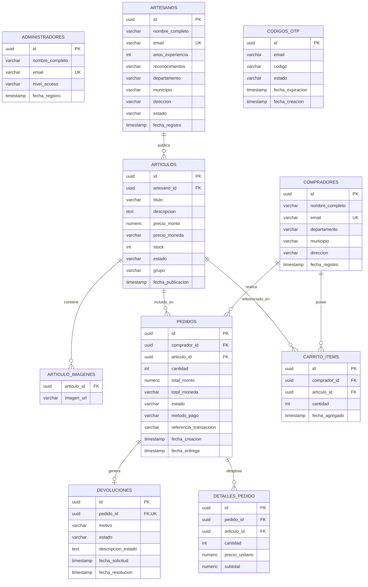

# Nexus Cultural S.A.S. — Modelo Arquitectural y Diccionario de Base de Datos Relacional

> **Documento:** NEXUS-DOC-BD-Modelo_Relacional_Diccionario_v1.0  
> **Proyecto:** Nexus Cultural (Plataforma Móvil de Comercio Electrónico Ancestral)  
> **Motor de Base de Datos:** PostgreSQL 15+  
> **ORM / Capa de Persistencia:** Spring Data JPA / Hibernate  
> **Fecha de Elaboración:** Octubre de 2026  
> **Ubicación Recomendada en Repositorio:** `documentacion/base_datos/MODELO_BASE_DATOS.md`

---

## 1. Diagrama Entidad-Relación 

---

## 2. Diccionario de Datos

### 2.1. Tabla: `administradores`
Representa al personal administrativo de Nexus Cultural con facultades de moderación y auditoría.

| Columna | Tipo de Dato | Nulo | Clave | Valor por Defecto | Descripción y Restricciones |
| :--- | :--- | :---: | :---: | :--- | :--- |
| `id` | `UUID` | No | **PK** | `gen_random_uuid()` | Identificador universal único del administrador. |
| `nombre_completo` | `VARCHAR(150)` | No | | | Nombre y apellidos del funcionario. |
| `email` | `VARCHAR(150)` | No | **UK** | | Correo institucional único. Formato RFC 5322. |
| `nivel_acceso` | `VARCHAR(30)` | No | | `'MODERADOR'` | Nivel de permisos: `SUPER_ADMIN`, `MODERADOR`, `AUDITOR`. |
| `fecha_registro` | `TIMESTAMP` | No | | `NOW()` | Fecha y hora de alta en la plataforma. |

---

### 2.2. Tabla: `artesanos`
Almacena la identidad y trayectoria de los maestros artesanos (adultos mayores / comunidades indígenas).

| Columna | Tipo de Dato | Nulo | Clave | Valor por Defecto | Descripción y Restricciones |
| :--- | :--- | :---: | :---: | :--- | :--- |
| `id` | `UUID` | No | **PK** | `gen_random_uuid()` | Identificador único del artesano. |
| `nombre_completo` | `VARCHAR(150)` | No | | | Nombre del artesano o maestro comunitario. |
| `email` | `VARCHAR(150)` | No | **UK** | | Correo electrónico para acceso mediante OTP. |
| `anos_experiencia` | `INT` | No | | `0` | Años de práctica en su oficio tradicional (>= 0). |
| `reconocimientos` | `VARCHAR(500)` | Sí | | | Premios, distinciones o trayectoria cultural. |
| `departamento` | `VARCHAR(100)` | No | | | Departamento de origen (e.g., La Guajira, Nariño). |
| `municipio` | `VARCHAR(100)` | No | | | Municipio o resguardo indígena. |
| `direccion` | `VARCHAR(200)` | No | | | Dirección física o referencia del taller. |
| `estado` | `VARCHAR(30)` | No | | `'ACTIVO'` | Estado operativo: `ACTIVO`, `INACTIVO`, `SUSPENDIDO`. |
| `fecha_registro` | `TIMESTAMP` | No | | `NOW()` | Fecha de registro en el sistema. |

---

### 2.3. Tabla: `compradores`
Contiene la información de los clientes nacionales e internacionales registrados.

| Columna | Tipo de Dato | Nulo | Clave | Valor por Defecto | Descripción y Restricciones |
| :--- | :--- | :---: | :---: | :--- | :--- |
| `id` | `UUID` | No | **PK** | `gen_random_uuid()` | Identificador único del comprador. |
| `nombre_completo` | `VARCHAR(150)` | No | | | Nombre del comprador. |
| `email` | `VARCHAR(150)` | No | **UK** | | Correo electrónico único de contacto y login. |
| `departamento` | `VARCHAR(100)` | No | | | Departamento de residencia y entrega. |
| `municipio` | `VARCHAR(100)` | No | | | Municipio de destino postal. |
| `direccion` | `VARCHAR(200)` | No | | | Dirección exacta para el despacho de mercancía. |
| `fecha_registro` | `TIMESTAMP` | No | | `NOW()` | Fecha de registro en la plataforma. |

---

### 2.4. Tabla: `articulos`
Catálogo central de obras y piezas artesanales publicadas.

| Columna | Tipo de Dato | Nulo | Clave | Valor por Defecto | Descripción y Restricciones |
| :--- | :--- | :---: | :---: | :--- | :--- |
| `id` | `UUID` | No | **PK** | `gen_random_uuid()` | Identificador único del artículo. |
| `artesano_id` | `UUID` | No | **FK** | | Referencia al artesano creador (`artesanos.id`). |
| `titulo` | `VARCHAR(200)` | No | | | Nombre comercial y ancestral de la obra. |
| `descripcion` | `VARCHAR(1000)`| No | | | Historia cultural, simbología y técnica utilizada. |
| `precio_monto` | `NUMERIC(12,2)`| No | | | Valor unitario en pesos colombianos (> 0). |
| `precio_moneda` | `VARCHAR(3)` | No | | `'COP'` | Código ISO 4217 de moneda. |
| `stock` | `INT` | No | | `1` | Cantidad de unidades disponibles (>= 0). |
| `estado` | `VARCHAR(30)` | No | | `'DISPONIBLE'` | `DISPONIBLE`, `AGOTADO`, `INACTIVO`. |
| `grupo` | `VARCHAR(50)` | No | | | Categoría: `Tejido`, `Cerámica`, `Orfebrería`, etc. |
| `fecha_publicacion` | `TIMESTAMP` | No | | `NOW()` | Fecha y hora en que la pieza fue publicada. |

---

### 2.5. Tabla: `articulo_imagenes`
Almacena las URLs de las fotografías alojadas en AWS S3 para cada artículo.

| Columna | Tipo de Dato | Nulo | Clave | Descripción y Restricciones |
| :--- | :--- | :---: | :---: | :--- |
| `articulo_id` | `UUID` | No | **FK** | Referencia al artículo (`articulos.id` ON DELETE CASCADE). |
| `imagen_url` | `VARCHAR(500)` | No | | URL pública en bucket S3 (`https://nexus-cultural-media-2026.s3...`). |

---

### 2.6. Tabla: `carrito_items`
Ítems activos en el carrito de compras de cada comprador.

| Columna | Tipo de Dato | Nulo | Clave | Valor por Defecto | Descripción y Restricciones |
| :--- | :--- | :---: | :---: | :--- | :--- |
| `id` | `UUID` | No | **PK** | `gen_random_uuid()` | Identificador del ítem en carrito. |
| `comprador_id` | `UUID` | No | **FK** | | Referencia al comprador propietario (`compradores.id`). |
| `articulo_id` | `UUID` | No | **FK** | | Referencia a la obra seleccionada (`articulos.id`). |
| `cantidad` | `INT` | No | | `1` | Unidades agregadas (debe ser >= 1). |
| `fecha_agregado` | `TIMESTAMP` | No | | `NOW()` | Marca temporal de adición. |

> **Nota de Auditoría:** La tabla actualmente carece de un índice único compuesto `UNIQUE(comprador_id, articulo_id)`, lo que facilita la duplicación accidental de ítems si se envía múltiples veces la misma solicitud.

---

### 2.7. Tabla: `pedidos`
Órdenes de compra generadas tras el checkout.

| Columna | Tipo de Dato | Nulo | Clave | Valor por Defecto | Descripción y Restricciones |
| :--- | :--- | :---: | :---: | :--- | :--- |
| `id` | `UUID` | No | **PK** | `gen_random_uuid()` | Identificador único de la orden de pedido. |
| `comprador_id` | `UUID` | No | **FK** | | Referencia al comprador que realizó el pedido. |
| `articulo_id` | `UUID` | No | **FK** | | Referencia al artículo comprado. |
| `cantidad` | `INT` | No | | `1` | Unidades adquiridas. |
| `total_monto` | `NUMERIC(12,2)`| No | | | Total pagado por la orden en COP. |
| `total_moneda` | `VARCHAR(3)` | No | | `'COP'` | Moneda de liquidación. |
| `estado` | `VARCHAR(30)` | No | | `'PENDIENTE'` | `PENDIENTE`, `CONFIRMADO`, `EN_CAMINO`, `ENTREGADO`, `CANCELADO`, `EN_DEVOLUCION`, `DEVUELTO`. |
| `metodo_pago` | `VARCHAR(50)` | Sí | | | Medio de pago utilizado (`CARD`, `PSE`, `WALLET`). |
| `referencia_transaccion` | `VARCHAR(100)` | Sí | | | Código de autorización o comprobante bancario. |
| `fecha_creacion` | `TIMESTAMP` | No | | `NOW()` | Fecha y hora de expedición de la orden. |
| `fecha_entrega` | `TIMESTAMP` | Sí | | | Fecha en que el transportador certifica entrega. |

---

### 2.8. Tabla: `devoluciones`
Registro de garantías y solicitudes de reembolso posventa.

| Columna | Tipo de Dato | Nulo | Clave | Valor por Defecto | Descripción y Restricciones |
| :--- | :--- | :---: | :---: | :--- | :--- |
| `id` | `UUID` | No | **PK** | `gen_random_uuid()` | Identificador de la solicitud de garantía. |
| `pedido_id` | `UUID` | No | **FK, UK** | | Pedido asociado (relación 1 a 1). |
| `motivo` | `VARCHAR(100)` | No | | | Causa de la devolución (defecto, no conformidad). |
| `estado` | `VARCHAR(30)` | No | | `'PENDIENTE'` | `PENDIENTE`, `APROBADA`, `RECHAZADA`. |
| `descripcion_estado` | `VARCHAR(500)`| Sí | | | Detalle del cliente sobre el problema presentado. |
| `fecha_solicitud` | `TIMESTAMP` | No | | `NOW()` | Fecha de radicación (máximo 5 días post-entrega). |
| `fecha_resolucion` | `TIMESTAMP` | Sí | | | Fecha de dictamen administrativo. |

---

### 2.9. Tabla: `codigos_otp`
Almacenamiento volátil para autenticación de un solo uso.

| Columna | Tipo de Dato | Nulo | Clave | Valor por Defecto | Descripción y Restricciones |
| :--- | :--- | :---: | :---: | :--- | :--- |
| `id` | `UUID` | No | **PK** | `gen_random_uuid()` | Identificador del registro OTP. |
| `email` | `VARCHAR(150)` | No | | | Correo del destinatario. |
| `codigo` | `VARCHAR(6)` | No | | | Código numérico de 6 dígitos. |
| `estado` | `VARCHAR(20)` | No | | `'PENDIENTE'` | `PENDIENTE`, `USADO`, `EXPIRADO`. |
| `fecha_expiracion` | `TIMESTAMP` | No | | | Vigencia temporal (fechaCreacion + 5 min). |
| `fecha_creacion` | `TIMESTAMP` | No | | `NOW()` | Momento exacto de emisión. |

---

## 3. Hallazgos y Vulnerabilidades en la Capa de Base de Datos

1. **Uso de `hibernate.ddl-auto=update` en Entornos Compartidos:**
   - La propiedad se encuentra activa en `application.properties`. Hibernate altera esquemas en caliente sin versionamiento, lo cual es de alto riesgo para producción ya que puede bloquear tablas o alterar columnas sin marcha atrás.
   - **Recomendación:** Desactivar `ddl-auto` (`validate` o `none`) e integrar **Flyway** o **Liquibase** para migraciones SQL inmutables y trazables.
2. **Ausencia de Restricción de Unicidad en `carrito_items`:**
   - Al no existir `CONSTRAINT uq_comprador_articulo UNIQUE (comprador_id, articulo_id)`, concurrencias o peticiones dobles insertan filas duplicadas en el carrito.
3. **Falta de Tareas Automáticas de Purga (Cleanup) en `codigos_otp`:**
   - No hay un `Scheduled task` o `pg_cron` que elimine registros de OTP expirados, lo que genera crecimiento desmedido de la tabla ante ataques de saturación.
4. **Exposición de Credenciales Productivas de AWS RDS:**
   - En el archivo `.env` se encuentran registradas credenciales en texto claro (`SPRING_DATASOURCE_URL`, `SPRING_DATASOURCE_PASSWORD=ABC1234*Q`) apuntando a una instancia real en `rds.amazonaws.com`.
   - **Recomendación:** Rotar las contraseñas en AWS RDS de manera inmediata y desacoplar las variables utilizando AWS Secrets Manager o Parameter Store.
